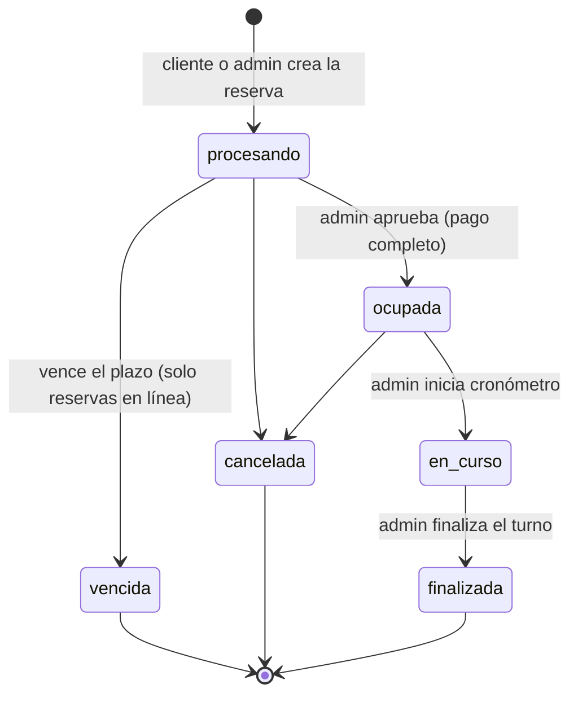

# ⚽ CanchaControl — Gestión de turnos y control de tiempo para canchas sintéticas

[](https://nodejs.org/)
[](https://expressjs.com/)
[](https://www.mysql.com/)
[](https://react.dev/)
[](https://vitejs.dev/)
[](https://mui.com/)
[](https://opensource.org/licenses/ISC)

**CanchaControl** es una aplicación web para administrar las reservas de canchas sintéticas de microfútbol. Resuelve los problemas típicos de la gestión en cuaderno o por llamada: **dobles reservas**, pérdida de información, falta de visibilidad de los horarios libres, control manual del tiempo y falta de verificación de quién puede ingresar.

- **Backend:** Node.js + Express 5 + MySQL/MariaDB (SQL nativo con `mysql2`, sin ORM) + JWT.
- **Frontend:** React 18 + Vite + Material UI (tema naranja), SPA con rutas protegidas por rol.
- **Pieza clave:** la tabla `court_slots` con `UNIQUE(court_id, slot_date, slot_start)` hace que **la propia base de datos impida la doble reserva**, incluso si dos personas guardan al mismo tiempo.

---

## 📑 Tabla de contenidos

1. [Funcionalidades](#1-funcionalidades)
2. [Roles y permisos](#2-roles-y-permisos)
3. [Stack tecnológico](#3-stack-tecnológico)
4. [Estructura del proyecto](#4-estructura-del-proyecto)
5. [Requisitos previos](#5-requisitos-previos)
6. [Puesta en marcha](#6-puesta-en-marcha)
7. [Variables de entorno](#7-variables-de-entorno)
8. [Base de datos y datos de demostración](#8-base-de-datos-y-datos-de-demostración)
9. [Ciclo de vida de una reserva](#9-ciclo-de-vida-de-una-reserva)
10. [API REST](#10-api-rest)
11. [Reglas de negocio](#11-reglas-de-negocio)
12. [Frontend: pantallas y rutas](#12-frontend-pantallas-y-rutas)
13. [Seguridad](#13-seguridad)
14. [Scripts disponibles](#14-scripts-disponibles)
15. [Pruebas](#15-pruebas)
16. [Copias de seguridad](#16-copias-de-seguridad)
17. [Estado del proyecto y limitaciones conocidas](#17-estado-del-proyecto-y-limitaciones-conocidas)
18. [Documentación relacionada](#18-documentación-relacionada)
19. [Licencia](#19-licencia)

---

## 1. Funcionalidades

**Acceso y usuarios**

- Inicio de sesión con correo y contraseña, y cierre de sesión.
- Registro público de clientes con aceptación del tratamiento de datos personales (Ley 1581 de 2012).
- Cambio de contraseña para cualquier usuario autenticado.
- Gestión de usuarios y roles por el administrador (crear, editar, activar/desactivar sin borrar historial).

**Agenda y disponibilidad**

- Agenda por cancha con los bloques del día, **visible sin iniciar sesión**.
- Estado de cada bloque con color **y** texto: disponible (verde), procesando (amarillo), ocupada (rojo), mantenimiento/bloqueado (gris) y pasado (gris claro).
- Navegación por fecha y consulta del precio de cada bloque según día y franja horaria.

**Reservas**

- Reserva en línea del cliente: queda **"procesando"** y vence sola si no se atiende en el plazo configurado.
- Reserva creada por el administrador a nombre de un cliente (nombre y teléfono).
- Código único de 6 caracteres por reserva.
- Reserva de varios bloques consecutivos (`duration_blocks`, desde la API).
- Reprogramación (solo fecha y hora, conserva precio y pagos) y cancelación con motivo.
- Búsqueda por código, nombre o teléfono, filtro por estado y paginación.
- Bloqueo de fechas y horas pasadas.

**Pagos**

- Registro de pagos de la reserva y de **tiempo adicional**, con medio de pago.
- Estado de pago derivado: `pendiente`, `parcial` o `pagado`.
- La reserva solo se aprueba cuando está **pagada por completo**.

**Control del tiempo y acceso**

- Cronómetro por cancha con tiempo restante y minutos extra; la hora de fin se guarda en la base de datos, por lo que **sobrevive a recargas**.
- Lista del día para vigilancia con **marca de ingreso** del cliente.

**Administración**

- Configuración de horario de atención, duración del bloque, retención de reservas en línea y anticipación mínima de cancelación.
- Gestión de canchas y tarifas por día (semana / fin de semana) y franja horaria.
- Reportes de ingresos, uso por cancha y reservas por estado, con rango de fechas.
- Auditoría de quién creó, modificó, canceló, cobró o bloqueó, y cuándo.

---

## 2. Roles y permisos

El rol nunca se acepta desde el registro público: los usuarios que se auto-registran son siempre `cliente`.

| Funcionalidad                                   | Público | Cliente | Admin | Dueño | Vigilancia |
| ----------------------------------------------- | :-----: | :-----: | :---: | :---: | :--------: |
| Ver disponibilidad                              |    ✔    |    ✔    |   ✔   |   ✔   |     ✔      |
| Reservar en línea (queda "procesando")          |         |    ✔    |       |       |            |
| Ver y cancelar sus propias reservas             |         |    ✔    |       |       |            |
| Crear reserva a nombre de un cliente            |         |         |   ✔   |       |            |
| Listar y buscar todas las reservas              |         |         |   ✔   |   ✔   |            |
| Registrar pagos, aprobar, reprogramar, cancelar |         |         |   ✔   |       |            |
| Cronómetros (iniciar / finalizar turno)         |         |         |   ✔   |       |            |
| Lista del día y marcar ingreso                  |         |         |   ✔   |       |     ✔      |
| Bloquear / desbloquear horarios (solo API)      |         |         |   ✔   |       |            |
| Reportes                                        |         |         |   ✔   |   ✔   |            |
| Usuarios, canchas, tarifas y configuración      |         |         |   ✔   |       |            |
| Cambiar su propia contraseña                    |         |    ✔    |   ✔   |   ✔   |     ✔      |

> **Nota:** el menú "Reservas" aparece también para el dueño, pero las acciones de pago, aprobación y cancelación están restringidas al administrador en la API, así que el dueño las verá rechazadas con 403.

---

## 3. Stack tecnológico

| Capa          | Tecnología             | Versión      | Propósito                                               |
| ------------- | ---------------------- | ------------ | ------------------------------------------------------- |
| Runtime       | Node.js                | 18+          | Ejecución del backend (módulos ES)                      |
| Framework     | Express                | ^5.1.0       | API REST (errores async reenviados al manejador global) |
| Base de datos | MySQL / MariaDB        | 10.11+       | Motor relacional                                        |
| Driver        | mysql2                 | ^3.11.0      | Pool de conexiones y transacciones                      |
| Autenticación | jsonwebtoken           | ^9.0.2       | JWT de acceso (8 h por defecto)                         |
| Hash          | bcryptjs               | ^2.4.3       | Contraseñas con bcrypt                                  |
| Configuración | dotenv                 | ^16.4.5      | Variables de entorno                                    |
| CORS          | cors                   | ^2.8.5       | Orígenes permitidos                                     |
| Dev           | nodemon                | ^3.1.0       | Recarga automática                                      |
| Pruebas       | Jest, Babel, Supertest | ^29.7 / ^7.0 | Pruebas unitarias e integración                         |
| Frontend      | React                  | ^18.3.1      | Interfaz                                                |
| Build         | Vite                   | ^5.4.0       | Servidor de desarrollo y build                          |
| Routing       | React Router DOM       | ^6.27.0      | Navegación SPA                                          |
| HTTP          | Axios                  | ^1.7.7       | Cliente de la API con interceptores                     |
| UI            | Material UI            | ^6.1.0       | Componentes e iconos                                    |
| Linter        | oxlint                 | ^0.9.0       | Análisis estático                                       |

---

## 4. Estructura del proyecto

```text
cancha-control/
├── README.md
├── DOCUMENTACION_REQUISITOS.md      # Requisitos, alcance, HU y trazabilidad
├── generar-reporte.ps1              # Genera un reporte de texto del proyecto (PowerShell)
├── reiniciar.bat                    # Atajo para Windows
├── backend/
│   ├── .env.example
│   ├── package.json
│   ├── babel.config.js
│   ├── jest.config.js
│   ├── TEST_PLAN.md                 # Plan de pruebas
│   ├── start.cmd · start_server.bat · fix.cmd   # Atajos para Windows
│   ├── scripts/
│   │   └── backup.js                # Copia de seguridad (mysqldump o mysql2)
│   ├── src/
│   │   ├── server.js                # Punto de entrada, CORS, montaje de rutas, job de vencimientos
│   │   ├── config/                  # db.js, constants.js, schema.sql, canchaControl.sql
│   │   ├── controllers/             # auth, booking, config, report, user
│   │   ├── middlewares/             # auth (protect, optionalAuth, authorize), error
│   │   ├── models/                  # User.js (SQL de usuarios)
│   │   ├── routes/                  # auth, user, booking, config, report
│   │   ├── services/                # booking, schedule, report, token
│   │   ├── utils/                   # AppError, asyncHandler, audit, time
│   │   ├── validators/              # domain.validator, user.validator
│   │   └── seeds/seed.js
│   └── tests/                       # Pruebas unitarias e integración
└── frontend/
    ├── .env.example
    ├── package.json
    ├── vite.config.js               # Puerto 5173
    ├── start.cmd · reload.cmd       # Atajos para Windows
    └── src/
        ├── main.jsx · App.jsx · index.css
        ├── api/axios.js             # Instancia con token e interceptor de sesión vencida
        ├── context/                 # AuthContext (sesión, inactividad), NotifyContext (avisos)
        ├── layouts/                 # AppLayout, PublicLayout, Agenda
        ├── components/              # Navbar, Sidebar
        ├── pages/                   # Login, Register, Bookings, MyBooking, Timers, Today,
        │                            # Reports, Users, Config, ChangePassword
        ├── routes/                  # ProtectedRoute, navigation (menú por rol)
        └── utils/format.js          # Formato de moneda, fecha y hora; inicio por rol
```

**Arquitectura del backend** (capas delgadas): `routes` (matriz de permisos) → `controllers` (HTTP) → `services` (reglas de negocio) → `models`/SQL → `db.js` (pool `mysql2`). Las operaciones con varias escrituras se ejecutan dentro de **transacciones** (`withTransaction`) y la auditoría se confirma o revierte junto con la acción.

---

## 5. Requisitos previos

| Herramienta     | Versión       | Propósito            |
| --------------- | ------------- | -------------------- |
| Node.js         | 18 o superior | Backend y frontend   |
| npm             | 9 o superior  | Gestor de paquetes   |
| MySQL o MariaDB | 8.0+ / 10.11+ | Base de datos        |
| Git             | —             | Control de versiones |

---

## 6. Puesta en marcha

### Backend

```bash
cd backend
cp .env.example .env        # Windows (cmd): copy .env.example .env
# Edita DB_PASSWORD y JWT_SECRET
npm install
npm run seed:reset          # Crea la BD, las tablas y datos de demostración (BORRA lo existente)
npm run dev                 # http://localhost:5000
```

### Frontend

```bash
cd frontend
cp .env.example .env        # Windows (cmd): copy .env.example .env
npm install
npm run dev                 # http://localhost:5173
```

### Verificar

```bash
curl http://localhost:5000/api/health
# { "success": true, "message": "Backend funcionando", "serverTime": "2026-11-01 17:45:42" }
```

### Usuarios de demostración

> ⚠️ Solo para desarrollo. Cámbialos o elimínalos antes de usar el sistema en producción.

| Rol           | Correo                       | Contraseña   |
| ------------- | ---------------------------- | ------------ |
| Administrador | admin@canchacontrol.com      | Admin123\*   |
| Dueño         | auditor@canchacontrol.com      | auditor123\*   |
| Vigilancia    | vigilancia@canchacontrol.com | Vigia123\*   |
| Cliente       | cliente@canchacontrol.com    | Cliente123\* |

---

## 7. Variables de entorno

### Backend (`backend/.env`)

| Variable                | Valor por defecto       | Descripción                                                                                      |
| ----------------------- | ----------------------- | ------------------------------------------------------------------------------------------------ |
| `PORT`                  | `5000`                  | Puerto del servidor                                                                              |
| `NODE_ENV`              | —                       | `development` activa el registro de peticiones; `test` evita arrancar el servidor en las pruebas |
| `DB_HOST`               | `localhost`             | Host de MySQL                                                                                    |
| `DB_PORT`               | `3306`                  | Puerto de MySQL                                                                                  |
| `DB_USER`               | `root`                  | Usuario de MySQL                                                                                 |
| `DB_PASSWORD`           | vacío                   | Contraseña de MySQL                                                                              |
| `DB_NAME`               | `cancha_control`        | Nombre de la base de datos                                                                       |
| `JWT_SECRET`            | — (**obligatoria**)     | Clave para firmar los JWT. Sin ella el servidor no inicia                                        |
| `JWT_EXPIRE`            | `8h`                    | Duración del token                                                                               |
| `FRONTEND_URL`          | `http://localhost:5173` | Origen principal permitido por CORS                                                              |
| `ALLOWED_FRONTEND_URLS` | —                       | Orígenes adicionales separados por coma                                                          |

CORS permite siempre `localhost`/`127.0.0.1` en los puertos 5174–5176 además de los configurados.

### Frontend (`frontend/.env`)

| Variable       | Valor por defecto           | Descripción        |
| -------------- | --------------------------- | ------------------ |
| `VITE_API_URL` | `http://localhost:5000/api` | URL base de la API |

> No subas los archivos `.env` al repositorio. Usa un `JWT_SECRET` largo y aleatorio en producción.

---

## 8. Base de datos y datos de demostración

El esquema está en `backend/src/config/schema.sql` (hay una copia sincronizada en `canchaControl.sql`). La zona horaria de cada conexión se fija en `-05:00` (Bogotá) y las fechas se devuelven como texto.

### Tablas

| Tabla         | Descripción                                                                                                                   |
| ------------- | ----------------------------------------------------------------------------------------------------------------------------- |
| `users`       | Usuarios con rol, estado activo, intentos fallidos, bloqueo temporal y fecha de aceptación de términos                        |
| `courts`      | Canchas con estado `activa`, `inactiva` o `mantenimiento`                                                                     |
| `settings`    | Configuración clave-valor (horario, bloque, retención, cancelación, nombre del negocio)                                       |
| `rates`       | Tarifas por cancha (o generales si `court_id` es nulo), tipo de día y franja horaria                                          |
| `holidays`    | Días festivos                                                                                                                 |
| `bookings`    | Reservas: código, cancha, fecha, hora, bloques, precio total, cliente, estado, vencimiento, cronómetro, ingreso y cancelación |
| `court_slots` | **Una fila por bloque ocupado o bloqueado**, con `UNIQUE(court_id, slot_date, slot_start)`                                    |
| `payments`    | Pagos de reserva o tiempo adicional, con medio de pago                                                                        |
| `audit_log`   | Quién hizo qué y cuándo (entidad, acción, detalle JSON)                                                                       |

Como cada bloque ocupado es una fila, liberar un bloque al cancelar o reprogramar es simplemente borrar sus filas de `court_slots`.

### Seed

```bash
npm run seed:reset   # DROP DATABASE + esquema + datos (destructivo)
npm run seed         # Aplica el esquema e inserta datos solo si no hay usuarios
```

Inserta: 4 usuarios de demostración, 3 canchas (Cancha 1 y 2 de 5 vs 5, Cancha 3 de 7 vs 7), la configuración inicial, las tarifas y 5 festivos.

| Configuración inicial          | Valor         |
| ------------------------------ | ------------- |
| Horario                        | 08:00 – 23:00 |
| Duración del bloque            | 60 min        |
| Retención de reservas en línea | 30 min        |
| Cancelación mínima             | 2 h           |

| Tarifas del seed (COP por bloque) | Semana                                | Fin de semana |
| --------------------------------- | ------------------------------------- | ------------- |
| Cancha 1 y 2                      | $50.000 (08–18 h) · $60.000 (18–23 h) | $80.000       |
| Cancha 3                          | $90.000                               | $120.000      |

---

## 9. Ciclo de vida de una reserva



1. **Crear:** el cliente (o el administrador a nombre de un cliente) elige un bloque disponible. La reserva queda en `procesando` y ocupa el bloque. Las reservas del cliente reciben `expires_at` (ahora + retención configurada); las del administrador no vencen.
2. **Pagar:** el administrador registra el pago (`reserva`). No se puede pagar más que el saldo pendiente.
3. **Aprobar:** solo con el pago completo; pasa a `ocupada` y se limpia el vencimiento.
4. **Cronómetro:** se inicia desde `ocupada`; pasa a `en_curso` y calcula la hora de fin (bloques × 60 min + minutos extra).
5. **Finalizar:** `en_curso` → `finalizada`.
6. **Cancelar / vencer:** se libera el bloque (se borran las filas de `court_slots`). Un job interno revisa los vencimientos cada minuto.

El ingreso del cliente (`checked_in_at`) se marca de forma independiente desde la lista del día.

---

## 10. API REST

Todas las rutas cuelgan de `/api`. Formato de respuesta:

```json
{ "success": true, "data": {} }
```

Errores:

```json
{ "success": false, "message": "Descripción del error" }
```

Los listados paginados devuelven `data`, `total`, `page`, `limit` y `totalPages`.

### Autenticación

| Método | Endpoint             | Descripción                                                                      | Acceso      |
| ------ | -------------------- | -------------------------------------------------------------------------------- | ----------- |
| `POST` | `/api/auth/register` | Registra un cliente (`name`, `email`, `phone`, `password`, `accept_terms: true`) | Público     |
| `POST` | `/api/auth/login`    | Inicia sesión (`email`, `password`) → `{ token, user }`                          | Público     |
| `GET`  | `/api/auth/me`       | Usuario de la sesión                                                             | Autenticado |
| `PUT`  | `/api/auth/password` | Cambia la contraseña (`current_password`, `new_password`)                        | Autenticado |

### Usuarios (solo administrador)

| Método | Endpoint                  | Descripción                                 |
| ------ | ------------------------- | ------------------------------------------- |
| `GET`  | `/api/users?page=&limit=` | Lista paginada (máx. 100 por página)        |
| `GET`  | `/api/users/:id`          | Detalle                                     |
| `POST` | `/api/users`              | Crea un usuario de cualquier rol            |
| `PUT`  | `/api/users/:id`          | Edita nombre, teléfono, rol y estado activo |

### Disponibilidad y reservas

| Método   | Endpoint                            | Descripción                                                     | Acceso            |
| -------- | ----------------------------------- | --------------------------------------------------------------- | ----------------- |
| `GET`    | `/api/availability?date=&court_id=` | Bloques por cancha con estado y precio                          | Público           |
| `GET`    | `/api/bookings`                     | Todas las reservas (`status`, `q`, `date`, `page`, `limit`)     | Admin, Dueño      |
| `GET`    | `/api/bookings/mis-reservas`        | Reservas del cliente autenticado                                | Cliente           |
| `GET`    | `/api/bookings/today`               | Reservas de hoy (lista del día)                                 | Admin, Vigilancia |
| `GET`    | `/api/bookings/timers`              | Turnos activos con segundos restantes                           | Admin             |
| `GET`    | `/api/bookings/:id`                 | Detalle (el cliente solo ve las suyas)                          | Cliente           |
| `POST`   | `/api/bookings`                     | Crea una reserva                                                | Cliente, Admin    |
| `POST`   | `/api/bookings/:id/confirm`         | Aprueba (exige pago completo)                                   | Admin             |
| `POST`   | `/api/bookings/:id/reschedule`      | Cambia fecha y hora                                             | Admin             |
| `POST`   | `/api/bookings/:id/cancel`          | Cancela con `reason`                                            | Cliente, Admin    |
| `POST`   | `/api/bookings/:id/payments`        | Registra un pago                                                | Admin             |
| `POST`   | `/api/bookings/:id/timer/start`     | Inicia el cronómetro (`extra_minutes` opcional)                 | Admin             |
| `POST`   | `/api/bookings/:id/finish`          | Finaliza el turno                                               | Admin             |
| `POST`   | `/api/bookings/:id/checkin`         | Marca el ingreso del cliente                                    | Admin, Vigilancia |
| `POST`   | `/api/blocks`                       | Bloquea un horario (`court_id`, `date`, `start_time`, `reason`) | Admin             |
| `DELETE` | `/api/blocks/:slotId`               | Elimina un bloqueo manual                                       | Admin             |

Ejemplo — crear una reserva:

```json
POST /api/bookings
{
  "court_id": 1,
  "date": "2026-11-07",
  "start_time": "18:00:00",
  "customer_name": "Juan Pérez",
  "customer_phone": "3001234567",
  "duration_blocks": 1
}
```

Ejemplo — registrar un pago:

```json
POST /api/bookings/12/payments
{ "amount": 60000, "kind": "reserva", "method": "efectivo", "note": "Pago completo" }
```

`kind` puede ser `reserva` o `tiempo_adicional`.

### Configuración

| Método                    | Endpoint                             | Descripción                                                      | Acceso       |
| ------------------------- | ------------------------------------ | ---------------------------------------------------------------- | ------------ |
| `GET`                     | `/api/courts`                        | Lista canchas (las inactivas solo las ve el administrador)       | Público      |
| `POST` / `PUT`            | `/api/courts`, `/api/courts/:id`     | Crea / edita una cancha (no se borran, para conservar historial) | Admin        |
| `GET`                     | `/api/settings`                      | Configuración general                                            | Público      |
| `PUT`                     | `/api/settings`                      | Actualiza la configuración                                       | Admin        |
| `GET`                     | `/api/rates`                         | Lista tarifas                                                    | Admin, Dueño |
| `POST` / `PUT` / `DELETE` | `/api/rates`, `/api/rates/:id`       | Gestiona tarifas                                                 | Admin        |
| `GET`                     | `/api/holidays`                      | Lista festivos                                                   | Público      |
| `POST` / `DELETE`         | `/api/holidays`, `/api/holidays/:id` | Gestiona festivos                                                | Admin        |

### Reportes (Admin, Dueño)

| Endpoint                            | Devuelve                                                                |
| ----------------------------------- | ----------------------------------------------------------------------- |
| `GET /api/reports/income?from=&to=` | Ingresos por día (reservas, tiempo adicional y total) y total del rango |
| `GET /api/reports/usage?from=&to=`  | Por cancha: total, completadas y canceladas                             |
| `GET /api/reports/status?from=&to=` | Cantidad de reservas por estado                                         |

### Códigos de estado frecuentes

| Código    | Significado                                                    |
| --------- | -------------------------------------------------------------- |
| 400       | Datos inválidos, horario pasado, pago que excede el saldo      |
| 401 / 403 | Sin sesión o sin permiso para la acción                        |
| 404       | Recurso no encontrado                                          |
| 409       | Horario ya ocupado o bloqueado, estado de reserva incompatible |
| 423       | Cuenta bloqueada temporalmente por intentos fallidos           |
| 429       | Demasiadas reservas en proceso del mismo cliente               |

---

## 11. Reglas de negocio

| Área                        | Regla                                                                                                                                 |
| --------------------------- | ------------------------------------------------------------------------------------------------------------------------------------- |
| **Doble reserva**           | Imposible por diseño: restricción `UNIQUE` en `court_slots`. Un conflicto responde 409                                                |
| **Horarios pasados**        | No se puede reservar, reprogramar ni bloquear un horario que ya pasó (hora del servidor, `America/Bogota`)                            |
| **Canchas**                 | Solo se reserva en canchas `activa`; en mantenimiento o inactivas responden 409                                                       |
| **Reservas en línea**       | Vencen pasados `online_hold_minutes` si siguen en `procesando`; un cliente puede tener como máximo **3** reservas en proceso a la vez |
| **Cancelación del cliente** | Solo sus propias reservas y con al menos `min_cancel_hours` de anticipación. El administrador cancela sin restricción de tiempo       |
| **No cancelables**          | Una reserva `finalizada` o ya `cancelada` no se puede cancelar                                                                        |
| **Reprogramación**          | Solo cambia fecha y hora; conserva duración, precio y pagos. Para otra tarifa o duración se cancela y se crea una nueva               |
| **Precio**                  | Se calcula al crear según cancha, tipo de día y franja, y se guarda en la reserva; cambiar tarifas no afecta reservas ya creadas      |
| **Pagos**                   | Un pago de `reserva` no puede exceder el saldo; no se cobra sobre reservas canceladas o vencidas                                      |
| **Aprobación**              | Solo reservas `procesando` y con estado de pago `pagado`                                                                              |
| **Cronómetro**              | Se inicia una sola vez, desde `ocupada`; el fin se guarda en la base de datos                                                         |
| **Código de reserva**       | 6 caracteres aleatorios sin caracteres ambiguos (sin `I`, `O`, `0`, `1`)                                                              |
| **Bloqueos**                | Solo se pueden eliminar los bloqueos manuales, no las reservas                                                                        |
| **Usuarios**                | Un administrador no puede quitarse su propio rol ni desactivarse                                                                      |
| **Contraseñas**             | Mínimo 8 caracteres con letras y números; bcrypt                                                                                      |

---

## 12. Frontend: pantallas y rutas

| Ruta                    | Pantalla                                                                                             | Acceso            |
| ----------------------- | ---------------------------------------------------------------------------------------------------- | ----------------- |
| `/`                     | Agenda pública con disponibilidad                                                                    | Público           |
| `/login` · `/register`  | Inicio de sesión y registro de clientes                                                              | Público           |
| `/app/agenda`           | Agenda con reserva (cliente y administrador)                                                         | Autenticado       |
| `/app/mis-reservas`     | Reservas propias, con cancelación                                                                    | Cliente           |
| `/app/reservas`         | Listado con filtros, búsqueda y menú de acciones (pagar, aprobar, reprogramar, cancelar, cronómetro) | Admin, Dueño      |
| `/app/cronometros`      | Tarjetas de cuenta regresiva por cancha, que se ponen en rojo al terminar el tiempo                  | Admin             |
| `/app/hoy`              | Lista del día con botón "Marcar ingreso"                                                             | Admin, Vigilancia |
| `/app/reportes`         | Ingresos, uso por cancha y por estado, con rango de fechas                                           | Admin, Dueño      |
| `/app/usuarios`         | Alta y edición de usuarios, rol y estado                                                             | Admin             |
| `/app/configuracion`    | Pestañas **General**, **Canchas** y **Tarifas**                                                      | Admin             |
| `/app/cambiar-password` | Cambio de contraseña                                                                                 | Todos             |

Pantalla de inicio tras iniciar sesión: administrador y dueño → `/app/reservas`; vigilancia → `/app/hoy`; cliente → `/app/agenda`.

---

## 13. Seguridad

- **Contraseñas** con bcrypt; nunca se guardan en texto plano.
- **JWT** obligatorio en rutas privadas; `JWT_SECRET` es requerido para arrancar.
- **Bloqueo por fuerza bruta:** tras 5 intentos fallidos la cuenta se bloquea 15 minutos (423).
- **Cierre por inactividad:** el frontend cierra la sesión tras 15 minutos sin interacción; el token en sí dura 8 horas.
- **Roles:** cada ruta declara los roles permitidos con `authorize(...)`; los usuarios desactivados no pasan la autenticación.
- **Privacidad:** sin sesión solo se ve el estado de los bloques; el cliente solo accede a sus reservas; el consentimiento de la Ley 1581 se guarda en `terms_accepted_at`.
- **Errores:** los errores 500 no exponen detalles al cliente; un `ER_DUP_ENTRY` de la base se traduce en 409.
- **SQL parametrizado** en todas las consultas.

---

## 14. Scripts disponibles

### Backend

| Script                  | Descripción                                                     |
| ----------------------- | --------------------------------------------------------------- |
| `npm run dev`           | Servidor con recarga automática (nodemon)                       |
| `npm start`             | Servidor en modo producción                                     |
| `npm run seed`          | Crea el esquema e inserta datos si no hay usuarios              |
| `npm run seed:reset`    | **Borra** la base y la vuelve a crear con datos de demostración |
| `npm test`              | Pruebas con Jest                                                |
| `npm run test:coverage` | Pruebas con reporte de cobertura                                |
| `npm run backup`        | Copia de seguridad de la base                                   |

### Frontend

| Script            | Descripción                          |
| ----------------- | ------------------------------------ |
| `npm run dev`     | Servidor de desarrollo (puerto 5173) |
| `npm run build`   | Build de producción                  |
| `npm run preview` | Vista previa del build               |
| `npm run lint`    | Análisis con oxlint                  |

---

## 15. Pruebas

El backend usa **Jest** con una base de datos de pruebas (`cancha_control_test`, configurada en `tests/setup.js`). Hay pruebas unitarias (tiempo, validadores, `AppError`, tarifas y bloques) y de integración (servicios de reservas y reportes, y los endpoints de autenticación, usuarios, reservas, configuración, reportes y disponibilidad).

```bash
cd backend
npm test                        # Linux / macOS
npm run test:coverage           # cobertura
```

En Windows (cmd) el prefijo `NODE_ENV=test` del script no funciona; ejecuta directamente:

```bash
node --experimental-vm-modules node_modules/jest/bin/jest.js
```

Las pruebas de integración necesitan MySQL disponible y la base de pruebas con el esquema aplicado. El detalle de la estrategia y los casos está en [`backend/TEST_PLAN.md`](backend/TEST_PLAN.md).

> ⚠️ Antes de confiar en la suite conviene revisarla: varios archivos importan `describe/it/expect` desde `"jest"` (no es un módulo válido para eso) y `tests/schedule.test.js` tiene un error de sintaxis (`close_time="10:00:00"` dentro de un objeto). Además, algunas pruebas esperan estados distintos a los que implementa el servicio actual.

**No se han hecho pruebas E2E ni del frontend en navegador.**

---

## 16. Copias de seguridad

```bash
cd backend
npm run backup                  # guarda en backend/backups/
npm run backup -- D:/respaldos  # carpeta de destino personalizada
```

El script usa `mysqldump` si está disponible; si no, exporta cada tabla a un archivo `.sql` con sentencias `INSERT` usando `mysql2`. La detección de `mysqldump` usa `which`, que no existe en Windows, por lo que allí se usará el modo por tablas. Es una copia **manual**: no hay respaldos automáticos ni restauración probada (depende del proveedor de hosting).

---

## 17. Estado del proyecto y limitaciones conocidas

**Pendiente o parcial**

- **Reservas recurrentes semanales:** aparecen como implementadas en la documentación de requisitos, pero no hay lógica de recurrencia en el servicio de reservas.
- **Bloqueo de horarios:** existe solo en la API (`/api/blocks`); la interfaz no tiene pantalla para crear o quitar bloqueos.
- **Festivos:** la API permite crearlos, pero no hay pantalla. Además, el validador de tarifas solo acepta `semana` y `finde`, y el seed no crea tarifas `festivo`; como el cálculo busca una tarifa de tipo `festivo` en esas fechas, **un día festivo puede quedar con precio 0** mientras no exista una tarifa de ese tipo.
- **Reportes:** los ingresos se agrupan por día (sin vista semanal o mensual), la ocupación es por cancha (no por franja horaria) y las cancelaciones se cuentan por estado sin mostrar el motivo.
- **Auditoría:** se registra en `audit_log`, pero no hay pantalla para consultarla.
- **Alertas del cronómetro:** hay cuenta regresiva visual y la tarjeta se pone en rojo al terminar; no hay aviso sonoro ni notificación previa al fin del turno.
- **Duración del turno:** el cronómetro calcula `bloques × 60` minutos, sin usar `block_minutes` si se cambia la duración del bloque.
- **Canchas y tarifas:** la interfaz permite crear (y eliminar tarifas), pero no editar; la API sí tiene `PUT`.
- **Medio de pago:** la interfaz ofrece efectivo, transferencia y tarjeta; confirma que el esquema acepte los tres valores.
- **Un turno cuyo cronómetro nunca se inicia** queda en `ocupada` y no pasa a `finalizada`.
- **Cambiar la duración del bloque** con reservas futuras puede desalinearlas.
- **Sin pruebas E2E** y reportes sin paginar.

**Antes de producción**

- En `development` el servidor registra cada petición con parte del token; además, el middleware `authorize` imprime un `console.log` en cada autorización y sus respuestas 401/403 incluyen un campo `debug` con el rol y la ruta. Elimina esos registros y respuestas de depuración.
- Todas las respuestas incluyen el encabezado de depuración `X-API-Version`.
- No hay `helmet` ni limitación de peticiones (rate limiting) en el servidor.
- Cambia las credenciales de demostración y usa un `JWT_SECRET` fuerte.
- Define el alojamiento en la nube y las copias de seguridad automáticas (RNF09 y RNF17).

**Fuera del alcance (por decisión de diseño):** pasarela de pago, facturación electrónica, app móvil nativa, notificaciones por WhatsApp, torneos, integración contable, venta de productos y alquiler de elementos. El sistema **solo registra** los pagos.

---

## 18. Documentación relacionada

- [`DOCUMENTACION_REQUISITOS.md`](DOCUMENTACION_REQUISITOS.md): objetivos, alcance, requisitos funcionales y no funcionales, historias de usuario y matriz de trazabilidad. Algunas marcas de "implementado" de ese documento son más optimistas que el código actual (ver sección 17).
- [`backend/TEST_PLAN.md`](backend/TEST_PLAN.md): estrategia y casos de prueba.

---

## 19. Licencia

Este proyecto está bajo la licencia **ISC**.

---

<div align="center">

**CanchaControl** — Gestión de turnos y control de tiempo para canchas sintéticas  
Desarrollado con Node.js, Express, MySQL, React y Material UI

</div>

